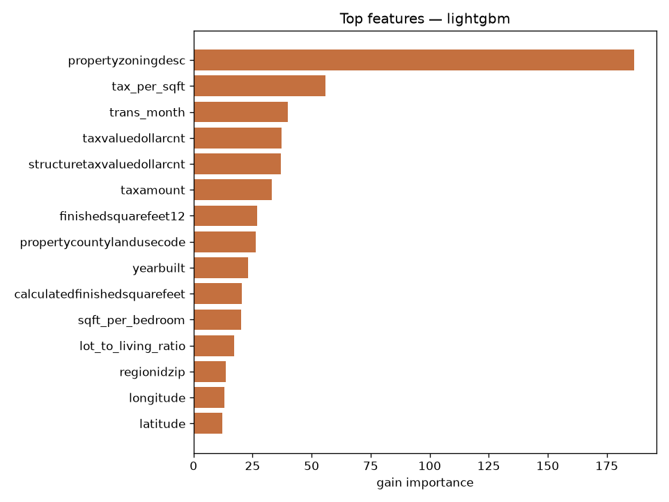
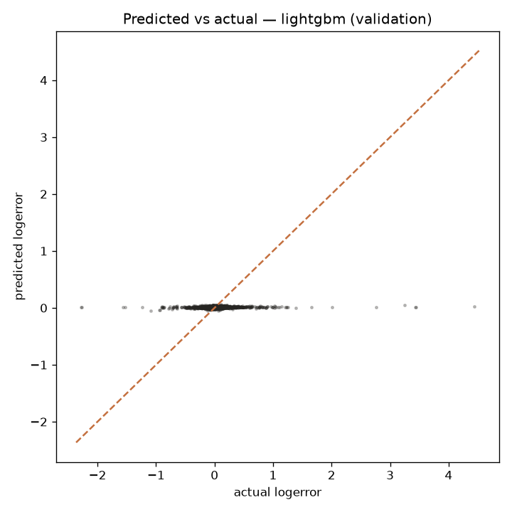

# Predicting Zillow Zestimate Errors with Machine Learning

Zillow's Zestimate predicts what a home will sell for — but every prediction
carries an error. This project asks a sharper question than "what is this home
worth?": **can we predict where Zillow's own model goes wrong, and by how much?**

If the error is predictable from a property's characteristics, Zillow can
correct its Zestimate before publishing it — turning a known weakness into a
better valuation for millions of homes.

## What is "logerror"?

For every home that sold, Zillow recorded how far off its Zestimate was:

```
logerror = log(Zestimate) − log(SalePrice)
```

- **Positive** logerror → the Zestimate **overvalued** the home
- **Negative** logerror → the Zestimate **undervalued** the home
- **Zero** → the Zestimate was exactly right

The task: predict this error from ~60 property attributes (size, rooms,
location, tax assessments, zoning, …). Models are scored with **MAE** (mean
absolute error) — the average size of the mistake, where smaller is better.
This is the same data and metric from Kaggle's $1M *Zillow Prize* competition.

## The data

| File | Rows | Contents |
|---|---|---|
| `train_2016_v2.csv` | 90,275 | Home sales in 2016 (Los Angeles, Orange, Ventura counties, CA): `parcelid`, `logerror`, `transactiondate` |
| `properties_2016.csv` | ~3M properties × 58 cols | Property features: bedrooms, bathrooms, square footage, year built, latitude/longitude, tax amounts, assessed values, zoning, … |

Each sale was joined to its property record on `parcelid` → **90,275 complete
rows**. Twenty columns were missing in over 90% of rows (basement sqft, pool
details, …) and were dropped, leaving **52 features** for modeling.

> The raw CSVs are too large to ship with this repo. Download them from the
> [Zillow Prize competition page](https://www.kaggle.com/competitions/zillow-prize-1/data)
> (free Kaggle account required) and place them in `data/`.

## How it works

**`eda.py`** — merges the datasets (streaming the 649 MB properties file and
keeping only the ~90K needed parcels), then profiles the target: logerror
distribution, missing-value rates per column, and correlations with the target.
Plots go to `outputs/`.

**`features.py`** — turns raw columns into model-ready signals:
- **Timing:** sale month and quarter from `transactiondate` (Zestimate accuracy drifts through the year)
- **Property age:** 2016 minus `yearbuilt`
- **Ratios:** living sqft per bedroom / per bathroom, property tax per sqft, lot-to-living-area ratio, total rooms
- **Log transforms** of right-skewed money and size fields
- **Categoricals** (zoning description, land-use code, county FIPS, …) passed as native LightGBM categoricals; tree models handle remaining missing values natively

**`train.py`** — 80/20 train/validation split (seed 42), then three models:
1. **Median baseline** — predict 0.006 (the training median) for every home. The bar to beat.
2. **LightGBM** — gradient-boosted trees, 64 leaves, early stopping on validation MAE.
3. **XGBoost** — depth 6, early stopping.

## Results (validation, n = 18,055)

| Model | MAE ↓ | RMSE | R² |
|---|---|---|---|
| Median baseline | 0.06835 | 0.16156 | −0.001 |
| **LightGBM** | **0.06822** | 0.16070 | 0.010 |
| XGBoost | 0.06868 | 0.16013 | 0.017 |

LightGBM wins on the competition metric (MAE). But the headline finding is an
honest one:

> **The Zestimate's error is mostly unpredictable noise.** The best model
> barely beats predicting the median for every home and explains only ~1% of
> the variance. Training longer makes validation *worse* — the model starts
> memorizing noise within ~15 boosting rounds. This matches the original $1M
> competition, where even the winners shaved only a few percent off baseline.
> Most of the error lives in factors this dataset can't see: a home's
> condition, renovations, micro-neighborhood trends.

### What mattered most (LightGBM gain importance)



1. **propertyzoningdesc** — zoning / land-use description
2. **tax_per_sqft** (engineered) — property tax ÷ living area
3. **trans_month** — month the home sold
4. **taxvaluedollarcnt** — county assessed property value
5. **structuretaxvaluedollarcnt** — county assessed structure value

The county's own tax-assessment numbers carry the most signal about where
Zillow's model slips, followed by zoning and sale timing.



The predicted-vs-actual plot tells the same honest story: predictions cluster
near zero while true errors spread wide — exactly what you'd expect when the
target is dominated by noise.

## Limitations

1. **Noise-dominated target** — see above. A negative result, reported plainly.
2. **Sparse features** — a third of attributes were missing for >90% of homes.
3. **Narrow scope** — one year (2016), three California counties; no 2017 data used.

## Reproduce

```bash
pip install -r requirements.txt   # pandas, scikit-learn, lightgbm, xgboost, matplotlib, seaborn
python eda.py     # merge + EDA plots -> outputs/
python train.py   # features + models -> outputs/
```

All randomness is seeded (42). Scripts read from `data/` and write to `outputs/`.

## Tech

Python · pandas · scikit-learn · LightGBM · XGBoost · matplotlib
